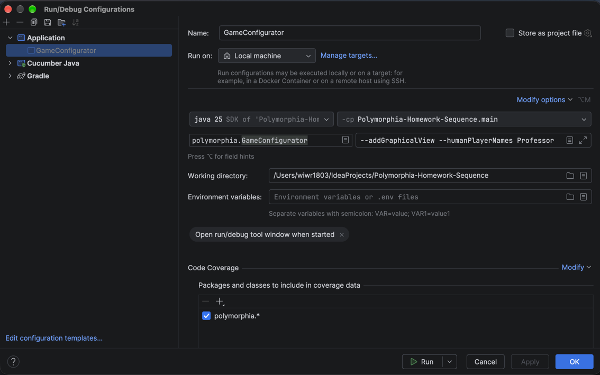
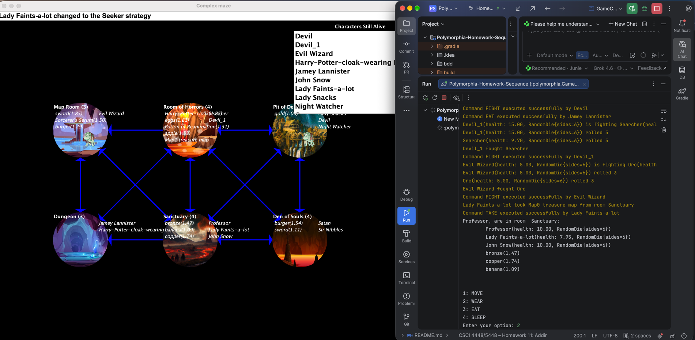

# Polymorphia Homework Sequence

Put all team members' names here:

    Names: <Team Members here>
    Java Version: 25
    Test Coverage Screenshot pasted below:
    ______________________________________
    Path Seeker took to the Treasure (rooms visited in sequence):

    Game Output pasted below (or linked):
    Test ran to produce the output below: <testname here>
    ______________________________________

# CSCI 4448/5448 – Homework 11: Adding Commands, a Human Player, and Command-Line Interface

## Introduction

Up until now, our Strategy class has decided on what action to take and then taken that action.
Now, we are going to apply the Single Responsibility Principle (SRP) so that the Strategy classes are responsible for
selecting what action to take, but not executing it. Our Strategy objects will now just
return an ICommand object, encapsulating the action to take.

You'll need to create Command for all the actions characters can take. Use good OO techniques in drying up these classes
and use a factory to decouple the code from concrete Command classes. This is mainly about moving around code. Here's
what you'll need to do:

* Create Commands for all the actions characters can take
* Use a factory to decouple the code from concrete Command classes
* Refactor Strategy classes to return ICommand objects

Next, you will add the ability for humans to play the game.
You’ll have to create a new strategy: the Human Strategy. This strategy will interact with the user
via the command line, which doesn’t play nice with automated tests, so you’ll isolate that code.

In this assignment, we will finally add a static main method to run our game from outside our
development environment. However, we’ll still run it, manually, from inside the development
environment to collect test coverage statistics. Here’s what you need to do:

* Create a Command-line Interface in a static main method
* Create Human Strategy

The starter intentionally does not compile. Completing this assignment requires substantial implementation, much of it moving existing action behavior into Command objects. The completed submission must build and satisfy the testing requirements below.

## Command Pattern

The actual action should take place in the Command classes.
The Strategy classes will be responsible for selecting the appropriate Command.

Use a simple factory pattern to reduce coupling to the Strategy classes.

The following illustrates the intended turn flow:

```java
protected void playTurn() {
  for (CharacterLocationPair pair : maze) {
    Character character = pair.character();
    IRoom room = pair.room();
    if (character.isAlive()) {
      ICommand command = character.getAction(room);
      command.executeCommand();
    }
  }
}
```

`ICommand.execute()` performs the action and returns whether it succeeded. The supplied `Command.executeCommand()` wrapper calls `execute()`, logs its result, and calls `turnTaken()` once. Use `executeCommand()` when playing a turn; do not call `turnTaken()` a second time. The wrapper currently charges a turn whether the action reports success or failure.

The current Character turn flow will be refactored into these two methods:

```java
ICommand getAction(...) {...}

void turnTaken() {
    loseHealth(HEALTH_LOST_IN_AGING_EACH_TURN);
}
```

The following is a partial illustration of an action method, not a complete implementation of `ICommand` (which also declares `getType()` and `optionString()`):
```java
public class SleepCommand implements ICommand {
  @Override
  public boolean execute() {
    return true;
  }
}
```

## Adding a static main method

In this homework, we’ll finally be adding a static main method. The application will still be driven mostly
through tests (what else can drive it automatically?), but we’ll have a manual test for human playing,
since we have to get input from a human.

We’re going to use a Command-Line Interface to drive our static main method so that we don’t have to
hard-code our game configuration. To parse the command-line arguments, you’ll use the Apache Commons
CLI library (https://commons.apache.org/proper/commons-cli/). To use this library, included the build.gradle
file is the following dependency:

```groovy
dependencies {
    implementation 'commons-cli:commons-cli:1.6.0'
}
```

Our static main method will not be on Polymorphia, though, as it has enough to do.
I've created a _GameConfigurator_ class, and you'll have to finish it. This
class serves the same purpose as our Polymorphia tests. It configures the game
with the characters and artifacts, optionally adds a graphical viewer, and
starts the game.

## Command-Line Arguments

Use the following command-line options to configure the game:

| Short Option | Long Option               | Argument                        | Description                             |
|--------------|---------------------------|---------------------------------|-----------------------------------------|
| `-a`         | `--numberOfArmoredSuits`  | `<integer>`                     | the number of armored suits in the maze |
| `-c`         | `--numberOfCreatures`     | `<integer>`                     | the number of creatures in the maze     |
| `-d`         | `--numberOfDemons`        | `<integer>`                     | the number of demons in the maze        |
| `-f`         | `--numberOfFoodItems`     | `<integer>`                     | the number of food items in the maze    |
| `-g`         | `--numberOfGluttons`      | `<integer>`                     | the number of gluttons in the maze      |
| `-h`         | `--help`                  | ``                              | the command help text                   |
| `-k`         | `--numberOfKnights`       | `<integer>`                     | the number of knights in the maze       |
| `-l`         | `--numberOfCloaks`        | `<integer>`                     | the number of cloaks in the maze        |
| `-m`         | `--numberOfTreasuresMaps` | `<integer>`                     | the number of treasure maps in the maze |
| `-o`         | `--numberOfCowards`       | `<integer>`                     | the number of cowards in the maze       |
| `-p`         | `--numberOfPotions`       | `<integer>`                     | the number of potions in the maze       |
| `-r`         | `--numberOfRooms`         | `<integer>`                     | the number of rooms in the maze         |
| `-s`         | `--numberOfSeekers`       | `<integer>`                     | the number of seekers in the maze       |
| `-t`         | `--numberOfTreasures`     | `<integer>`                     | the number of treasures in the maze     |
| `-w`         | `--numberOfWeapons`       | `<integer>`                     | the number of weapons in the maze       |
| `-x`         | `--addGraphicalView`      | ``                              | add a graphical display of the maze     |
| `-y`         | `--humanPlayerNames`      | `"<name1>,<name2>,...,<nameN>"` | the human player names                  |

You will have to finish the buildMazeFromArguments and createAndStartGame() methods.

## Adding a Human Player

To get input from a human, you’ll make a Human Strategy class and pass an
instance of it to one of the adventurers. To do this, you’ll make a new method
on the CharacterFactory. The IStrategy _getAction()_ method should prompt
the user for their desired action via the command line. It should look like this:

```terminaloutput
You are in room Fangorn Forest:
Dragon(health: 1.50)
Ogre(health: 0.50)
Professor(health: 8.90)
apple(1.4)

1: EAT
2: FIGHT
3: MOVE
4: SLEEP
Enter your option: 2
Your chosen option is FIGHT
Select opponent:

1. Dragon
2. Ogre

Enter your option: 2
```

The command choices presented to the human must be valid, meaning they will
change from room to room. Once selected, the strategy option creates and
returns the appropriate command. Once the CommandType is selected, you'll then
present a list of specific choices, like who to fight or what food to eat. If
there is only one choice, for example, a room with only one food item and you
chose to EAT, then don't present the second level of choices and just return the
only command.

There should always be the option to Move or Sleep, but options to Eat, Fight, Wear Armor,
etc. will be dependent upon what is in the room.

Here’s some example code to get you going on querying the user:

```java
CommandType getTopLevelChoice(List<ICommand> options, Character character, Room room) {
  Set<CommandType> availableCommandTypes = options.stream().map(ICommand::getType).collect(Collectors.toSet());

  Map<Integer, CommandType> optionMap = new HashMap<>();
  System.out.print(character.getName() + ", are in room " + room + "\n\n");
  while (true) {  // This exits the method if a valid option is selected
    System.out.print("Enter your option: ");
    Scanner scanner = new Scanner(System.in);

    int choiceNumber = Integer.parseInt(scanner.nextLine());
    ...
  }

```

Notice that there is a new type: _CommandType_ which is part of _ICommand_.
Also added to _ICommand_, is _optionString()_, which will help in printing
the second-level menu. The starter supplies `CommandType`. `getType()` and `optionString()` are declared on `ICommand`; implementing the remaining commands is part of the assignment.

## Testing the Command Line Interface and Human Play

To test your CLI, you'll need to set up a Run Configuration for your main method on the GameConfigurator class. Your
configuration should look something like this:



Then when you run this, with these options, your screen should look like this, with you entering commands at the console
and watching the game in our Maze Observer:



## Rubric

60 total points:

* Create Commands for all the actions characters can take (15 points)
* Refactor the Strategy classes to return ICommand objects (15 points)
* Create Human Strategy (15 points)
* Create a Command-line Interface in a static main method (15 points)

For all code submissions, the following will be required:

* The project builds with Gradle and runs successfully
* All BDD tests pass
* Adding any assumptions about your implementation in this README.md file. If anything
  isn't specified to your satisfaction in the homework description, that means you
  are free to decide for yourself. Make sure to document your assumptions here.

This is a group assignment, as will be all the remaining homework assignments.
You will submit the URL of your team’s course-provided private GitHub repository.

# Submission and Grading

The submission will be a URL to the GitHub repository. The repository should contain well-structured OO Java
code for the Polymorphia simulation
and a README file that has the names of the team members, the Java version,
and any other comments on the work. Document any assumptions or interpretations of the problem.
Only one team member should submit the private team repository URL in Canvas. A separate JAR upload is not required. Include the items requested at the top of this README: team member names, Java version, test coverage screenshot, the Seeker's path, game output and the test that produced it. Document your assumptions as described above.

## GitHub Guidelines

Course staff will provide one private GitHub repository per team and invite the team members as collaborators. Accept your invitation and contact staff if you cannot access your repository. Only one team member should submit the team repository URL in Canvas. Keep the repository private.

Please contact the class staff if you encounter technical difficulties or have questions about the setup process.

## Overall Project Guidelines

See Canvas for the confirmed due date, late-submission cutoff, and course late policy.

Use office hours, e-mail, or Piazza to reach the class staff regarding homework/project questions or if you have issues
completing the assignment.

# Homework Sequence
This sequence of homework assignments is designed to
give you practice in OO design and implementation using
the four pillars of OO:

* Abstraction
* Polymorphism
* Inheritance
* Encapsulation

Along with the SOLID principles:

* Single Responsibility Principle
* Open for Extension; Closed for Modifications
* Liskov Substitution Principle (IS-A relationship)
* Interface Fidelity Principle
* Dependency Injection

Plus:

* DRY (Don't Repeat Yourself)
* KISS (Keep It Simple, Stupid)
* YAGNI (You Ain't Gonna Need It)
